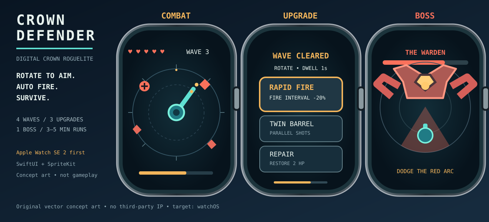

# CROWN DEFENDER

**Digital Crown-only arcade roguelite for Apple Watch.**

> **Status:** Game design / pre-production. The visual above is an original SVG concept mockup, **not a running game screenshot**. No watchOS build or Apple Watch SE 2 device test has been completed.

## Core idea

Protect a central turret as hostile drones approach from all directions. Rotate the **Digital Crown** to aim continuously through 360°. Your turret fires automatically. Survive waves, select one of three random upgrades, combine weapons, then defeat a multi-phase boss. The run is designed for about 3–5 minutes.

The **watch side button and Crown press are NOT gameplay inputs**: the buttons are managed by watchOS. All game actions and menus should be usable with **Crown rotation alone**. Menu selections use rotate-to-highlight and an explicit visual dwell countdown; a first rotation is required before auto-confirming.

## MVP scope

| Feature | MVP |
|---|---|
| Hardware | Apple Watch SE 2 first, 40 and 44 mm |
| Control | Crown rotation only; no mandatory tap or hardware side-button press |
| Gameplay | Fixed central turret, continuous 360° aim, automatic shots |
| Run | 4 waves, 3 between-wave upgrades, 1 boss |
| Enemies | Drone, Spinner, Sprinter; boss The Warden |
| Progression | Score / best run / limited local unlocks |
| Technology | Standalone watchOS, SwiftUI + SpriteKit; deterministic game logic |
| Dependencies | No server, accounts, paid AI API, advertising or iPhone companion in MVP |

## Start here

1. **[GROK_START_HERE.md](GROK_START_HERE.md)** — copy/paste execution brief for Grok on MacBook Neo.
2. [Game design](docs/GAME_DESIGN.md) — states, combat, enemies, boss, weapon upgrades, balance.
3. [Technical design](docs/TECHNICAL_DESIGN.md) — input, SpriteKit integration, architecture, persistence.
4. [Art and UX](docs/UX_ART_DIRECTION.md) — watch UI design, visual tokens, accessibility.
5. [Build plan](docs/IMPLEMENTATION_PLAN.md) — phases M0–M4 and acceptance gates.
6. [QA](docs/QA_ACCEPTANCE.md) — game/system tests and explicit evidence required.
7. [Concept art](assets/concept/crown-defender-watch-concept.svg) — original editable SVG.

## Source of truth / known limitations

- Repository owner: `hero1356-kor`; repository: `crown-defender`; **already exists**. Do **not** run `gh repo create` again.
- The repository was created as **public** by its owner. Do not change visibility without user instruction.
- Target watch is **thought** to be SE 2; model and watchOS version still need real verification.
- Confirm Xcode and watchOS SDK actually installed on MacBook Neo before choosing a deployment target.
- Plan for a stable **30 FPS floor** on SE 2; 60 FPS is an aspiration requiring profiling, not a promise.
- Pausing/resuming and focus transfer are first-class acceptance criteria.
- Do not claim the Watch game has been coded, compiled or tested until commands and results prove it.

## Repo workflow for coding agents

Clone the existing repository (instead of overwriting/reinitializing), work in small branches/commits, run the build and tests available on the machine, and record proof in `docs/ENVIRONMENT_REPORT.md` and `docs/TEST_RESULTS.md`. Never copy tokens or secrets from unrelated projects or touch the user's Samsung server / Alpha Council setup.

Apple documentation: [digitalCrownRotation](https://developer.apple.com/documentation/swiftui/view/digitalcrownrotation(_:)) · [SpriteKit](https://developer.apple.com/documentation/spritekit) · [WatchKit](https://developer.apple.com/documentation/watchkit).

## License

No license has been selected. Do not incorporate third-party assets, copyrighted characters or audio without proper rights. Design files in this repository are original project concepts.
